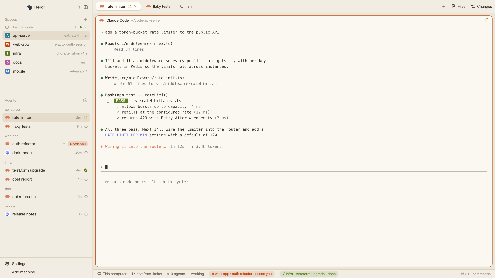

# Latte Deck

A warm, low-glare light layout for [Herdr](https://herdr.dev), made for running many coding agents at once.



- **Cream paper, terracotta accent**: easy on the eyes for long sessions of reading agent output.
- **Agents grouped by space**: the agents list gets twice the sidebar room of the spaces list.
- **A status bar that tells you who needs you**: agents that are blocked or finished while you weren't looking show up as chips. Click one to jump to it.

## Install

Ask the agent you use with Herdr:

> Add herdr.dev/layouts/ShouZhuo0413/latte-deck

Or copy the files yourself into your Herdr app home (`~/.config/herdr-app`, or `$HERDR_APP_HOME`):

```sh
git clone https://github.com/ShouZhuo0413/latte-deck
cd latte-deck
H="${HERDR_APP_HOME:-$HOME/.config/herdr-app}"
cp layouts/latte-deck.json layouts/latte-deck.svg "$H/layouts/"
cp themes/latte-deck.json "$H/themes/"
cp -R mods/latte-deck-status "$H/mods/"
herdr-app check "$H/mods/latte-deck-status"
herdr-app do layout.switch '{"name":"latte-deck"}'
```

Then click the layers icon in the Agents header and choose **Grouped by space**.

Your own layout stays as it was: `ctrl-shift-l` switches back. To remove Latte Deck, delete the three copied files and the mod folder.

## How it's built

[RECIPE.md](RECIPE.md) has the full brief: sizes, colors, the status chips' behavior, and what to watch out for. The status bar mod makes no network requests, runs no programs and reads no files.
