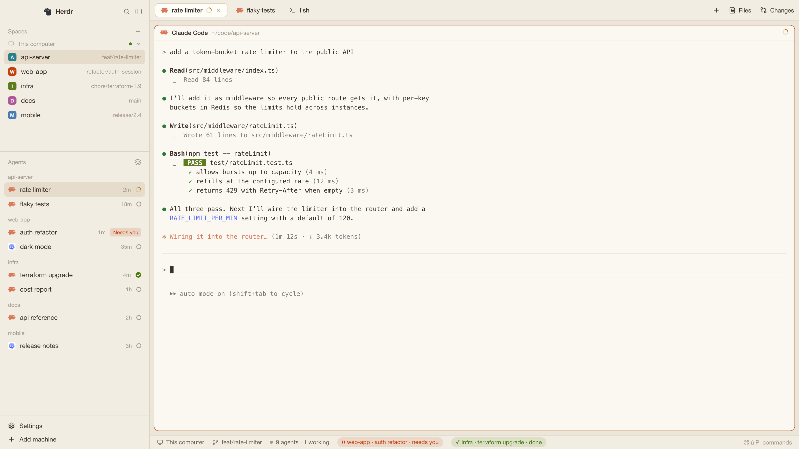

# Latte Deck

A warm, low-glare light layout for running many coding agents at once. The
window is cream paper with a terracotta accent; the sidebar lists your spaces
and, below them, every agent grouped by space; the status bar names each
agent that needs you or finished while you weren't looking, and clicking one
takes you there. It is Herdr's own `main` layout, retuned for long reading and
for keeping a dozen agents in view.

## What you see

Left to right, top to bottom:

- **Sidebar**, 300 px wide (folds to a compact rail), `chrome` `#f2ede3`:
  - Brand row, 46 px (shipped `workspace-chrome`): logo, search, sidebar toggle.
  - Spaces list (shipped `spaces`), weight 1, at least 90 px.
  - Agents list (shipped `agents`), weight 2, at least 90 px: twice the room of
    the spaces list, because agents outnumber spaces.
  - Footer, 69 px (shipped `workspace-chrome` with `footer: true`): Settings,
    Add machine.
- **Tab bar**, 42 px (shipped `tabs`): tab pills, `+`, Files, Changes.
- **The shown tab**, inside 8 px padding on `canvas` `#ece6da`: each pane is
  a card on the terminal background `#fbf8f2`, radius 10, 1 px `border`
  `#ddd3c1`, 1 px `accent` `#c0622f` while focused, with the shipped `pane`
  header (30 px, top, always shown) even when the tab has one pane.
- **Files / Changes panel** on the right, 368 px (280 to 900), hidden until
  opened from the tab bar.
- **Status bar**, 28 px (`latte-deck-status`), 11.8 px text in `muted`
  `#6f6355`: the machine, the shown space's branch, `N agents · N working`,
  then up to 4 chips, `+N` for the rest, and the palette hint on the right.

Theme `latte-deck` (`themes/latte-deck.json`): terminal background `#fbf8f2`,
foreground `#3a3027`, selection `#eadfc9`; chrome `#f2ede3`, canvas `#ece6da`,
selected row `#e5dccb`, border `#ddd3c1`, dim `#a3978a`, accent `#c0622f`;
status colors working `#b7791f`, blocked `#c2410c`, done `#4d7c0f`, idle
`#a3978a`. The 16 ANSI colors are darkened to stay readable on cream (ansi7
`#c9bfae`, ansi15 `#e5dccb`).

## How it behaves

- **blocked** (an agent needs a person): a chip `⏸ <space> › <tab> · needs you`
  in `blocked` `#c2410c` on the same color at 12% (`1f`), 20 px high, radius
  10, 9 px side padding.
- **done** (finished while nobody looked): a chip `✓ <space> › <tab> · done`
  in `done` `#4d7c0f`, same shape. It turns idle, and the chip goes, once
  someone looks at that agent.
- Chips are ordered blocked first, then by most recent change. Hover darkens
  the chip background to 20% (`33`). Clicking a chip runs
  `agent.focus {terminal}`: the window shows that agent's space and tab.
- **working** agents are counted (`· 2 working`), with no chip; **idle**
  agents are only counted in `N agents`.
- With nothing blocked or done, the status bar shows only machine, branch and
  counts.
- Everything else (sidebar, tabs, panes, panel) behaves exactly like `main`.

## Built from

- `layouts/latte-deck.json`: a clone of shipped `main` (Herdr 0.1.16) with
  root `theme: "latte-deck"` and `preview: "layouts/latte-deck.svg"`; node
  `sidebar` `size.px` 300 (was 268); node `agents` `size.weight` 2 (was 1);
  node `status` `content.mod` `latte-deck-status` (was `workspace-status`).
  Tree: `root` row → `sidebar` column (`brand`, `sidebar-lists` column of
  `spaces` + `agents`, `sidebar-footer`) and `work` column (`tabs`,
  `work-body` row of `main` tab block + hidden `panel` column holding a
  `panel-body` stack of `files` and `changes`, `status`).
- `layouts/latte-deck.svg`: the 320×200 settings preview.
- `themes/latte-deck.json`: the theme. Named like the layout, so it is the
  layout's own (Settings offers it only there).
- `mods/latte-deck-status/`: a clone of shipped `workspace-status`, adding
  the chips. Reads `spaces()`, `agents()` (`status`, `space_name`,
  `tab_name`, `seq`, `address`), `theme()`, `keys()`, `window()`. Runs
  `agent.focus` and `app.palette`. It makes no network requests, runs no
  programs and reads no files; its only assets are the shipped
  `mods/workspace-chrome/{monitor,server,branch}.svg` icons.
- Shipped mods used as they are: `workspace-chrome`, `spaces`, `agents`,
  `tabs`, `pane`, `files`, `changes`.

## Watch out

- Copy `themes/latte-deck.json` too, not only the layout and mod: the layout
  names it as its theme.
- Grouping agents by space is not part of the layout: it is the shipped
  `agents` mod's sort, kept in shared state. Click the layers icon in the
  Agents header and pick "Grouped by space" to match the preview.
- `done` comes from Herdr's attention bookkeeping, not from a program
  reporting `done`: a terminal that reports `state=done` directly stays idle,
  and in testing a working spell of about 3 seconds did not count while 8
  seconds did.
- Chip tints append a hex alpha to theme colors (`color + "1f"`), so the
  theme's `blocked` and `done` must be `#rrggbb`.
- Chips use the tab's own name (`tab_name`): an unnamed tab shows its number,
  where the agents list shows the agent's live title.
- Terminal programs with their own fixed dark theme will look wrong on cream.
  Claude Code's `theme: "auto"` switches to its light palette by itself.
- `preview.png` is rendered with demo data from the real theme colors and
  Herdr's own icons, and was checked against a live `herdr-app shot`; system
  fonts stand in for Geist and JetBrains Mono.

## Done when

- `herdr-app check mods/latte-deck-status` passes.
- `herdr-app do layout.switch '{"name":"latte-deck"}'`, then `herdr-app status`
  shows `"layout": "latte-deck"` and `"errors": []`.
- The window matches the preview: cream terminal `#fbf8f2`, `#f2ede3`
  sidebar 300 px wide, the agents list taller than the spaces list, a
  `#c0622f` border on the focused pane.
- A tab running `sh -c 'printf "\033]7501;state=blocked\007"; sleep 60'`
  puts a `needs you` chip in the status bar, and clicking it shows that tab.
- A tab that is not shown, running
  `sh -c 'printf "\033]7501;state=working\007"; sleep 8; printf "\033]7501;state=idle\007"; sleep 60'`,
  gets a `done` chip after it goes idle.
- With no blocked or done agents, no chips are shown.
